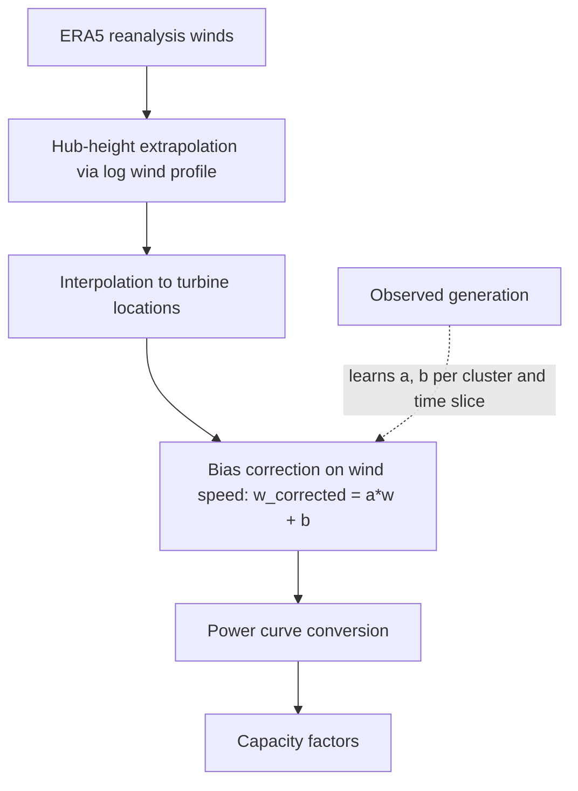

# The Python Virtual Wind Farm (PyVWF) model

[](https://github.com/ellyess/PyVWF/actions/workflows/ci.yml)
[](https://pyvwf.readthedocs.io/en/latest/)
[](https://www.python.org/)
[](LICENSE)
[](https://doi.org/10.5281/zenodo.21236619)

PyVWF turns atmospheric reanalysis (ERA5) into bias-corrected wind power
generation. It began as a Python implementation of the
[VWF model](https://github.com/renewables-ninja/pyvwf) by Iain Staffell, which
underpins the wind simulations on
[Renewables.ninja](https://www.renewables.ninja/), and has grown into its own
model: it implements the granular bias-correction method of
[Benmoufok et al. (2024)](https://doi.org/10.1016/j.energy.2024.133759), and
extends it with a validation harness that fits and scores the correction
against observed generation in fifteen regions, at turbine and country level.

It was written by hand during a PhD from 2022 and has been developed AI-natively,
with Claude Code, since mid-2026: [how it is built, and an error the process
caught](docs/design/ai-native-development.md).

Raw reanalysis winds carry systematic, location-dependent biases, so capacity
factors simulated straight from ERA5 drift away from what fleets actually
generate. PyVWF learns a per-cluster, per-time-slice affine correction of the
**wind speed** (`w_corrected = a*w + b`) from observed generation, then converts
the corrected wind to power, so the non-linear speed-to-power step operates on
corrected winds. Unlike API-only tools, it exposes the full *training*
workflow, so the factors are yours to inspect, map and retrain at whatever
spatial resolution and time slice your observations support. Results here are
improved on rather than preserved: a recorded output is superseded by a better
one, and the code state behind each published result is kept in
[publications.md](docs/publications.md) so the number can still be read.



Every run writes a manifest recording the package version, the git state, the
region config and the curve library behind the numbers, and
[`pyvwf.viz`](docs/guides/visualisation.md) turns it into diagnostic figures,
including maps of what the correction learned per cluster.

## If you have five minutes

- **What it does, and how well:** the [results table](#results) below, corrected
  against uncorrected error in fifteen regions, each on a test year it never
  saw, including the region where the correction makes things worse.
- **Where each number comes from:** the [scorecard](docs/scorecard.md),
  with the run directory and the fit quality behind every row.
- **How it is built:** [development with coding agents](docs/design/ai-native-development.md),
  and its [case study](docs/design/ai-native-development.md#case-study-a-stale-comparison-in-the-physics-informed-study)
  of an agent's error caught, tested and withdrawn on the record.
- **One study from registration to result:** the turbine-only terrain study,
  [registered](https://github.com/ellyess/PyVWF/blob/archive/research-2026-10-27/docs/findings/method-physics-informed-turbine-prereg.md) before
  any fit and [reported](https://github.com/ellyess/PyVWF/blob/archive/research-2026-10-27/docs/findings/method-physics-informed-turbine.md) with
  the control that failed it.
- **A negative result:** [why correction factors do not
  transfer](docs/results.md#why-corrections-do-not-transfer) between
  regions.

## Installation

```bash
conda env create -f environment.yaml && conda activate pyvwf
```

Or into any Python >= 3.10 environment, `pip install -e .`. Seven extras add
data acquisition, the development tools, the docs build, the gridded surfaces,
the parallel offset fit, the physics-informed correction and the TouchDesigner
export; the
[installation guide](docs/guides/installation.md) says what each needs, and a
[Docker image](docs/guides/installation.md#docker) carries the scientific stack ready built.

## Quickstart

No downloads, a few seconds, synthetic weather and observations:

```bash
python examples/run_minimal.py
```

With your own data, `pyvwf-validate` runs one region through the harness, the
preferred path, from its config in `configs/regions/`:

```bash
pyvwf-validate train --region configs/regions/nz.toml
pyvwf-validate evaluate --region configs/regions/nz.toml \
    --train-run output/validation/NZ/train-<timestamp>
```

`transfer` is the third verb: it applies one region's factors to another. See
the [training guide](docs/guides/training.md), and `pyvwf-validate --help`.

## Documentation

Hosted at [pyvwf.readthedocs.io](https://pyvwf.readthedocs.io/), and readable as
plain Markdown in [`docs/`](docs/README.md), which indexes every page.

- [Data sources and preprocessing](docs/guides/data-sources.md): input formats, sources per region, preprocessing.
- [Training and evaluation](docs/guides/training.md): the region config, the input root, and train / evaluate / transfer.
- [Adding a region](docs/guides/adding-a-region.md): every file a new region touches, in order.
- [Adding a study](docs/guides/adding-a-study.md): where a study's documents, driver and runs go.
- [Results](docs/results.md): every study's result, including the negative ones, and the [research archive](docs/archive.md) that holds the full records.

## Results

Capacity-factor RMSE before and after correction, each region scored on
training years and a single test year it never saw. Turbine-level rows score
each farm or turbine; country-level rows score the national series, simulated
on each grid's representative turbine.

| Region | Level | Train → test | Uncorrected | Corrected |
|---|---|---|---|---|
| Germany (DE) | turbine | 2015-18 → 2019 | 0.086 | **0.057** † |
| Denmark (DK) | turbine | 2015-19 → 2020 | 0.148 | **0.085** § |
| Brazil (BR) | turbine | 2021-23 → 2024 | 0.130 | **0.097** † |
| United States (US) | turbine | 2019-21 → 2022 | 0.108 | **0.096** † |
| Australia (AU-NEM) | turbine | 2020-22 → 2023 | 0.116 | **0.079** † |
| United Kingdom (UK) | turbine | 2015-18 → 2019 | 0.139 | 0.116 † ‡ |
| New Zealand (NZ) | turbine | 2019-23 → 2024 | 0.157 | 0.105 ‡ |
| Chile (CL) | turbine | 2021-23 → 2024 | 0.110 | 0.104 † ‡ |
| Argentina (AR) | turbine | 2021-23 → 2024 | 0.140 | **0.122** † |
| France (FR) | country | 2015-21 → 2023 | 0.019 | 0.022 † (worse) |
| Belgium (BE) | country | 2015-21 → 2023 | 0.081 | **0.018** |
| Ireland (IE) | country | 2017-21 → 2023 | 0.045 | **0.021** |
| Sweden (SE) | country | 2015-21 → 2023 | 0.092 | **0.027** |
| Norway (NO) | country | 2015-21 → 2023 | 0.131 | **0.026** † |
| Spain (ES) | country | 2015-21 → 2023 | 0.071 | **0.030** |

The correction lowers RMSE in all nine turbine-level fleets and in five of the
six country-level ones; in France it raises it, from 0.019 to 0.022. Read the
numbers with their markers:

- **†** The fit is degenerate: a cluster's scalar falls outside 0.2 to 3.0 or its
  offset did not converge. The aggregate is real, but the per-cluster factors
  are not all usable. Seven of the nine turbine-level rows and two of the six
  country-level rows carry it; only Denmark and New Zealand are clean at
  turbine level.
- **‡** The gain cannot be distinguished from zero when the test year's units
  are resampled.
- **§** A small share of the fleet lies outside the loaded ERA5 extent, and its
  winds were extrapolated.
- Italy and Portugal are suspended: on their representative turbine's curve
  most of their fits are refused. The Netherlands is excluded for a defect in
  its observed series.
- One test year per region, and screening-level throughout, not an accredited
  yield assessment.

Every number, its source path, its fit quality and the size of each marked
share are in the [scorecard](docs/scorecard.md), which is their home;
`tests/test_readme_results.py` checks this table against it. The regions where
the correction does not help are on the
[results page](docs/results.md).

## Physics-informed correction (experimental)

`pyvwf.pinn` is a research alternative to the affine correction, for a region
with no observed generation to fit against. It replaces the fitted factors with
four bounded physical quantities learned inside a differentiable forward
operator. It is under active study, is not wired into the harness, has no
stable API, and needs the optional `pinn` extra; the method and its results are
on the [results page](docs/results.md#physics-informed-correction).

## Limitations

- **The correction is statistical, not physical.** Wake effects are not
  modelled explicitly, and the choice of power curve strongly influences the
  result.
- **Screening-level, not an accredited yield assessment.** Nothing here is
  MEASNET or DNV accredited, and none of it is investment advice.
- **One test year per region.** The reportable result is the drop from
  uncorrected to corrected. Orderings between two close configurations are not
  meaningful, and neither is the exact best cluster count.

The full list is in [docs/design/limitations.md](docs/design/limitations.md).

## Citation

Please cite both the software and the method paper. The Zenodo DOI is the
*concept* DOI; for the exact version you ran, take the version-specific DOI
from the [record](https://doi.org/10.5281/zenodo.21236619).

> Benmoufok, E. F., Warder, S. C., and Piggott, M. D. *PyVWF: An open Python
> framework for bias-corrected wind power simulation from reanalysis data.*
> Zenodo. [doi:10.5281/zenodo.21236619](https://doi.org/10.5281/zenodo.21236619)

> Benmoufok, E. F., Warder, S. C., Zhu, E., Bhaskaran, B., Staffell, I., and
> Piggott, M. D. (2024). *Improving wind power modelling through granular
> spatial and temporal bias correction of reanalysis data.* Energy.
> [doi:10.1016/j.energy.2024.133759](https://doi.org/10.1016/j.energy.2024.133759)

The method is also applied in Wang et al. (2026), *Energy Conversion and
Management*, [doi:10.1016/j.enconman.2026.121066](https://doi.org/10.1016/j.enconman.2026.121066).
Machine-readable metadata is in [`CITATION.cff`](CITATION.cff), and the commit
behind each published result in [publications.md](docs/publications.md).

## How this is built

PyVWF began as the code of the maintainer's PhD at Imperial College London,
written by hand from 2022 through the thesis: the method, the affine correction
and its first validation predate any coding agent. Since mid-2026 it has been
developed AI-natively, with Claude Code, a coding agent, under written rules and
guards a machine checks. The maintainer still owns the method, the gates and
every scientific decision; agents implement changes, write tests, draft
documents and critique proposals, and each diff is shown to the maintainer
before it is committed. The rules are in [AGENTS.md](AGENTS.md), and
[agent-guards.md](docs/design/agent-guards.md) records the failures behind
each guard and what each guard misses. How agents are used, with counts and a
worked example of an error the process caught, is in
[ai-native-development.md](docs/design/ai-native-development.md).

## Contributing

Contributions are welcome, especially documentation, new bias-correction
methods, validation case studies and performance work. See
[CONTRIBUTING.md](CONTRIBUTING.md) for development setup, tests and pull-request
guidelines, and open an issue to discuss larger changes first.

## Credits, contact and licence

PyVWF is developed by Ellyess F. Benmoufok (benmoufok.ellyess@gmail.com). The
original VWF model is by Iain Staffell (i.staffell@imperial.ac.uk). PyVWF is
part of the [Renewables.ninja](https://renewables.ninja) project, developed by
Stefan Pfenninger and Iain Staffell.

PyVWF is released under the [BSD-3-Clause licence](LICENSE), as is the bundled
open library of power curves, which derives from the NREL turbine-models
archive. Licensed curve libraries and confidential observations are not
redistributed; [data sources](docs/guides/data-sources.md) gives each source's
terms.
