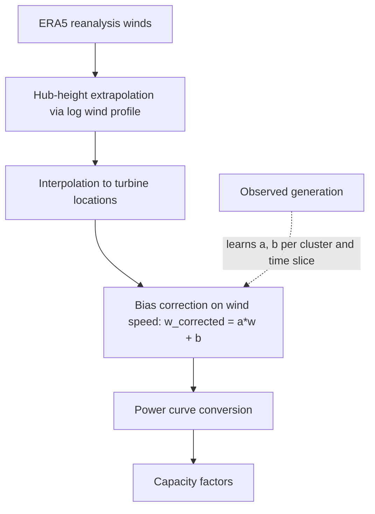

# The Python Virtual Wind Farm (PyVWF) model

[](https://github.com/ellyess/PyVWF/actions/workflows/ci.yml)
[](https://pyvwf.readthedocs.io/en/latest/)
[](https://www.python.org/)
[](LICENSE)
[](https://doi.org/10.5281/zenodo.21236619)

PyVWF turns atmospheric reanalysis (ERA5) into bias-corrected wind power
generation. It began as a Python implementation of the
[VWF model](https://github.com/renewables-ninja/pyvwf) by Iain Staffell, which
underpins the wind simulations on
[Renewables.ninja](https://www.renewables.ninja/), and implements the granular
bias-correction method of
[Benmoufok et al. (2024)](https://doi.org/10.1016/j.energy.2024.133759), with a
validation harness that fits and scores the correction against observed
generation in fifteen regions, at turbine and country level.

Raw reanalysis winds carry systematic, location-dependent biases, so capacity
factors simulated straight from ERA5 drift away from what fleets generate.
PyVWF learns a per-cluster, per-time-slice affine correction of the **wind
speed** (`w_corrected = a*w + b`) from observed generation, then converts the
corrected wind to power, so the non-linear speed-to-power step operates on
corrected winds. It exposes the whole training workflow, so the factors are
yours to inspect, map and retrain at whatever spatial resolution and time slice
your observations support. Every run writes a manifest recording the package
version, the git state, the region config and the curve library behind its
numbers, and [`pyvwf.viz`](docs/guides/visualisation.md) turns it into
diagnostic figures, including maps of what the correction learned per cluster.



## Install and run

```bash
git clone https://github.com/ellyess/PyVWF.git
cd PyVWF
pip install -e .
python examples/run_minimal.py   # synthetic data, no downloads, a few seconds
```

With conda, replace the `pip` line with
`conda env create -f environment.yaml && conda activate pyvwf`.

The example runs the whole workflow on bundled synthetic weather and
observations and prints the error the correction removed. Five optional extras
add data acquisition, development tools, the docs build, the parallel offset
fit and the physics-informed correction; the
[installation guide](docs/guides/installation.md) says what each needs, and
covers the Docker image.

To correct your own fleet, supply two CSV files, unit metadata and monthly
generation, and the harness fits and scores the correction:
[your own fleet data](docs/guides/training.md#your-own-fleet-data). To run a
shipped region, build its inputs with its [runbook](docs/runbooks/nz.md) (each
region has one) and run its config:

```bash
pyvwf-validate train --region configs/regions/nz.toml
pyvwf-validate evaluate --region configs/regions/nz.toml \
    --train-run output/validation/NZ/train-<timestamp>
```

That is the maintained config, which sweeps its cluster counts. To reproduce a
row of the table below, run the row's scorecard config under the input root its
curve library needs, as the scorecard's
[Reproducing a row](docs/scorecard.md#reproducing-a-row) section describes.

The [training guide](docs/guides/training.md) covers the region config, the
input root that decides which power-curve library a run uses, and the
`transfer` command.

Working with a coding agent in a checkout? The
[`run-pyvwf` skill](skills/run-pyvwf/SKILL.md) takes it through the same steps:
installing, the example, a region or your own fleet, and reading what the run
wrote. Claude Code finds it through `.claude/skills`; point another agent at
the file.

## Results

The correction lowers the error in fourteen of the fifteen regions below, and
makes France worse; most fits carry a caveat marker, and the corrections do not
transfer between regions
([why](docs/results.md#why-corrections-do-not-transfer)). Capacity-factor RMSE
before and after correction, each region scored on
training years and a single test year it never saw. Turbine-level rows score
each farm or turbine; country-level rows score the national series, simulated
on each grid's representative turbine.

| Region | Level | Train → test | Uncorrected | Corrected |
|---|---|---|---|---|
| Germany (DE) | turbine | 2015-18 → 2019 | 0.086 | **0.057** † |
| Denmark (DK) | turbine | 2015-19 → 2020 | 0.148 | **0.085** § |
| Brazil (BR) | turbine | 2021-23 → 2024 | 0.130 | **0.097** † |
| United States (US) | turbine | 2019-21 → 2022 | 0.108 | **0.096** † |
| Australia (AU-NEM) | turbine | 2020-22 → 2023 | 0.116 | **0.079** † |
| United Kingdom (UK) | turbine | 2015-18 → 2019 | 0.139 | 0.116 † ‡ |
| New Zealand (NZ) | turbine | 2019-23 → 2024 | 0.157 | 0.105 ‡ |
| Chile (CL) | turbine | 2021-23 → 2024 | 0.110 | 0.104 † ‡ |
| Argentina (AR) | turbine | 2021-23 → 2024 | 0.140 | **0.122** † |
| France (FR) | country | 2015-21 → 2023 | 0.019 | 0.022 † (worse) |
| Belgium (BE) | country | 2015-21 → 2023 | 0.081 | **0.018** |
| Ireland (IE) | country | 2017-21 → 2023 | 0.045 | **0.021** |
| Sweden (SE) | country | 2015-21 → 2023 | 0.092 | **0.027** |
| Norway (NO) | country | 2015-21 → 2023 | 0.131 | **0.026** † |
| Spain (ES) | country | 2015-21 → 2023 | 0.071 | **0.030** |

The correction lowers RMSE in all nine turbine-level fleets and in five of the
six country-level ones; in France it raises it, from 0.019 to 0.022. Read the
numbers with their markers:

- **†** The fit is degenerate: a cluster's scalar falls outside 0.2 to 3.0 or its
  offset did not converge. The aggregate is real, but the per-cluster factors
  are not all usable. Seven of the nine turbine-level rows and two of the six
  country-level rows carry it; only Denmark and New Zealand are clean at
  turbine level.
- **‡** The gain cannot be distinguished from zero when the test year's units
  are resampled.
- **§** A small share of the fleet lies outside the loaded ERA5 extent, and its
  winds were extrapolated.
- Italy and Portugal are suspended: on their representative turbine's curve
  most of their fits are refused. The Netherlands is excluded for a defect in
  its observed series.
- One test year per region, and screening-level throughout, not an accredited
  yield assessment.

Every number, the run behind it, its fit quality and the size of each marked
share are in the [scorecard](docs/scorecard.md), which is their home;
`tests/test_readme_results.py` checks this table against it. Every study
behind it, negative results included, has an entry on the
[results page](docs/results.md).

## Physics-informed correction (experimental)

`pyvwf.pinn` is a research alternative to the affine correction, for a region
with no observed generation to fit against. It replaces the fitted factors with
four bounded physical quantities learned inside a differentiable forward
operator. It is under active study, is not wired into the harness, has no
stable API, and needs the optional `pinn` extra; the method and its results are
on the [results page](docs/results.md#physics-informed-correction).

## Limitations

- **The correction is statistical, not physical.** Wake effects are not
  modelled explicitly, and the choice of power curve strongly influences the
  result.
- **Screening-level, not an accredited yield assessment.** Nothing here is
  MEASNET or DNV accredited, and none of it is investment advice.
- **One test year per region.** The reportable result is the drop from
  uncorrected to corrected. Orderings between two close configurations are not
  meaningful, and neither is the exact best cluster count.

The full list is in [docs/design/limitations.md](docs/design/limitations.md).

## How this is built

PyVWF was written by hand during the maintainer's PhD at Imperial College
London from 2022: the method, the affine correction and its first validation
predate any coding agent. Since mid-2026 it has been developed with Claude Code,
a coding agent, under written rules ([AGENTS.md](AGENTS.md)) and guards a
machine checks. The maintainer owns the method, the gates and every scientific
decision, and sees each diff before it is committed.

- [Development with coding agents](docs/design/ai-native-development.md): who
  decides what, which guards a machine enforces and what each misses, the
  failure behind each rule, the mistakes that reached publication, and a
  [case study](docs/design/ai-native-development.md#case-study-a-stale-comparison-in-the-physics-informed-study)
  of an agent's error caught and withdrawn on the record.
- Pre-registered studies: gates fixed before the run they judge, and kept when
  they fail. [One study](https://github.com/ellyess/PyVWF/blob/archive/research-2026-10-27/docs/findings/method-physics-informed-turbine-prereg.md)
  was registered before any fit and
  [reported](https://github.com/ellyess/PyVWF/blob/archive/research-2026-10-27/docs/findings/method-physics-informed-turbine.md)
  with the control that failed it.
- The research record is archived whole at tag `archive/research-2026-10-27`
  ([what is there and how to cite it](docs/archive.md)).

## Documentation

Hosted at [pyvwf.readthedocs.io](https://pyvwf.readthedocs.io/), and readable as
plain Markdown in [`docs/`](docs/README.md): the guides (installation, data
sources, training, outputs, adding a region or a study), one runbook per region,
the [scorecard](docs/scorecard.md), the [results](docs/results.md) and the
design notes.

## Citation

Please cite both the software and the method paper. The Zenodo DOI is the
*concept* DOI; for the exact version you ran, take the version-specific DOI
from the [record](https://doi.org/10.5281/zenodo.21236619).

> Benmoufok, E. F., Warder, S. C., and Piggott, M. D. *PyVWF: An open Python
> framework for bias-corrected wind power simulation from reanalysis data.*
> Zenodo. [doi:10.5281/zenodo.21236619](https://doi.org/10.5281/zenodo.21236619)

> Benmoufok, E. F., Warder, S. C., Zhu, E., Bhaskaran, B., Staffell, I., and
> Piggott, M. D. (2024). *Improving wind power modelling through granular
> spatial and temporal bias correction of reanalysis data.* Energy.
> [doi:10.1016/j.energy.2024.133759](https://doi.org/10.1016/j.energy.2024.133759)

The method is also applied in Wang et al. (2026), *Energy Conversion and
Management*, [doi:10.1016/j.enconman.2026.121066](https://doi.org/10.1016/j.enconman.2026.121066).
Machine-readable metadata is in [`CITATION.cff`](CITATION.cff), the commit
behind each published result in [publications.md](docs/publications.md), and
the research archive's own citation in [archive.md](docs/archive.md).

## Contributing

Contributions are welcome, especially documentation, new bias-correction
methods, validation case studies and performance work. See
[CONTRIBUTING.md](CONTRIBUTING.md) for setup, tests and pull-request guidelines,
and open an issue to discuss larger changes first.

## Credits, contact and licence

PyVWF is developed by Ellyess F. Benmoufok (benmoufok.ellyess@gmail.com). The
original VWF model is by Iain Staffell (i.staffell@imperial.ac.uk). PyVWF is
part of the [Renewables.ninja](https://renewables.ninja) project, developed by
Stefan Pfenninger and Iain Staffell.

PyVWF is released under the [BSD-3-Clause licence](LICENSE), as is the bundled
open library of power curves, which derives from the NREL turbine-models
archive. Licensed curve libraries and confidential observations are not
redistributed; [data sources](docs/guides/data-sources.md) gives each source's
terms.
